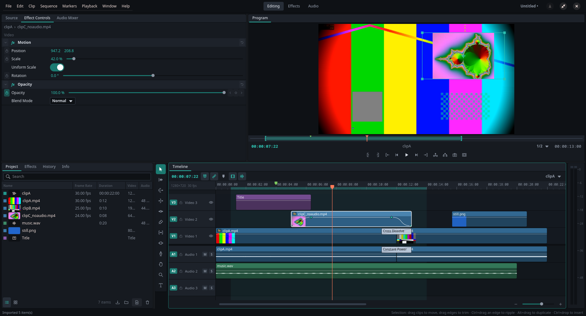

# Tideline

A non-linear video editor for Linux, written for Arch. It follows the workflow
professional editors share — source and program monitors, a project bin, a
multitrack timeline with trim tools, effect controls with keyframes — on top of
[MLT](https://www.mltframework.org/), FFmpeg and GTK 4.



## Run it

Everything it needs is in the Arch repositories:

```sh
sudo pacman -S --needed python python-gobject python-cairo python-numpy gtk4 libadwaita \
    mlt ffmpeg frei0r-plugins sdl2 qt6-base qt6-svg qt6-5compat rubberband
sudo pacman -S --needed whisper-cpp   # optional: auto captions
./run.sh                      # from this directory, no install needed
./run.sh project.tideline     # open a project
```

To install it as a package (menu entry, icon, `tideline` command, `.tideline` file type):

```sh
makepkg -si
```

On other distributions, install the same dependencies from your package
manager and run `./install.sh` (into `~/.local`; `--uninstall` removes it).

**AppImage** — one file that runs without installing anything, on distributions
whose C library is at least as new as the build machine's:

```sh
chmod +x Tideline-0.0.4-x86_64.AppImage
./Tideline-0.0.4-x86_64.AppImage                 # or with a project file
```

It carries Python, GTK 4, libadwaita, MLT, FFmpeg, frei0r and Qt; the graphics
driver, display server, sound server and fonts come from your system. Build
one from this directory with `python packaging/appimage/build.py` (it bundles
the libraries installed on the build machine, checks that the result starts,
and packs it with `appimagetool`, downloading that once if it is not
installed). Build on the oldest distribution you want to support, for example
in a container, to reach the most systems. `--appdir` stops before packing.

## What it does

**Project panel** — import files or folders (dialog or drag and drop), list and
icon views with thumbnails, bins, search, labels, relink offline media. New
items: sequences, titles, colour mattes, black video, bars and tone.

**Source monitor** — preview a clip, mark In/Out, then Insert (`,`) or
Overwrite (`.`) into the timeline, or drag the picture onto a track. Three-point
edits use the sequence In/Out when set.

**Timeline** — any number of video and audio tracks; linked audio/video;
snapping; thumbnails and waveforms; markers; track target, lock, hide, mute and
solo; sequences nested inside sequences. Tools:

| Key | Tool | Key | Tool |
|-----|------|-----|------|
| V | Selection (move, trim; Ctrl = ripple, Alt = duplicate, Ctrl-drop = insert) | Y | Slip |
| A | Track Select Forward | U | Slide |
| B | Ripple Edit | P | Pen (opacity / volume keyframes on the clip) |
| N | Rolling Edit | H | Hand |
| R | Rate Stretch | Z | Zoom |
| C | Razor (Shift = all tracks) | T | Type (click in the Program monitor) |

**Editing commands** — lift, extract, ripple delete (clips or gaps), add edit,
ripple trim to playhead (`Q` / `W`), nudge, copy/paste/paste insert, duplicate,
speed/duration with reverse and optional ripple, time remapping, enable/disable, link/unlink,
match frame. Unlimited undo through a History panel.

**Program monitor** — playback with J/K/L shuttle, loop and In-to-Out
playback, playback resolution, safe margins, frame export. Drag a selected clip
in the picture to move it; drag a corner to scale it.

**Project settings** — **File ▸ Project Settings** (Ctrl+Shift+P) sets the
aspect ratio (16:9, 9:16, 1:1, 4:5, 4:3, 21:9… or any custom size), resolution,
frame rate and sample rate. It reshapes the open sequence (or every sequence)
and is what new sequences start with. Clips keep their place in the frame:
positions and their keyframes move in proportion. Sequence Settings has the
same aspect ratio and resolution pickers for one sequence.

**Effects** — every clip has Motion (position, scale, rotation), Opacity with
blend modes, Volume and Balance. 68 more effects (52 video, 16 audio: colour
correction, curves, LUTs, blurs, keying, crop, distortion, stylise, EQ,
dynamics, pitch…) come from the Effects panel, each editable in Effect Controls.

**RGB Curves** — **Effects ▸ Color ▸ RGB Curves** draws master, red, green and
blue curves in an editor inside Effect Controls, over the histogram of the
Program picture. Click to add a point, drag to move it (the other channels
show faintly behind), double-click or right-click to remove it, or select a
point and nudge it with the arrow keys (Shift for bigger steps). The curve is
a monotone cubic through the points, the same one FFmpeg's `curves` filter
draws, so what the editor shows is what renders; each drag is one undo step.

**Scopes** — the **Scopes** panel (Shift+8, beside Project and Effects) measures
the Program monitor, or the Source monitor, as it plays: a **waveform** (luma,
RGB overlay, or luma with Cb and Cr), an **RGB parade**, a **vectorscope** with
75 % colour bar targets and the skin tone line, and a **histogram** of red,
green, blue and luma with the share of crushed and clipped pixels; or all four
at once. Luma and colour difference use the Rec. 709 coefficients. The
**Colour** workspace (Alt+Shift+4) puts Effect Controls beside the Program
monitor and the Scopes under it, for grading.

**Keyframes on everything** — every parameter of every effect has a stopwatch:
numbers and positions, colours, switches, choices (blend mode, alignment,
wave…), and a title's text, font, size and style. Numbers, positions and
colours blend along a curve; switches, choices and text step at their
keyframes. The exceptions are Motion's Uniform Scale, which only links the two
scale rows, and RGB Curves, whose curves are edited as a whole.

**Animate** — seven effects that move the picture without keyframes: Shake
(seeded camera shake with position, rotation and zoom, optionally scaled to
hide its edges), Oscillate (sine, triangle, square, sawtooth or bounce; also
circular), Spin, Pulse (to a tempo), Pan & Zoom, Strobe and Flicker. Their
Amount can itself be keyframed, and Effect Controls plots the resulting motion
over the clip.

**Keyframe graphs** — an animated parameter folds out a graph (the curve
button beside its keyframe controls). Drag keyframes in time and value (Shift
locks an axis), double-click to add one, drag the handles of the selected
keyframe to draw a custom Bezier curve, and right-click for presets: linear,
hold, ease, sine, expo, overshoot, elastic and bounce. Dragging empty space
scrubs the playhead. A colour is drawn as its red, green, blue and alpha
curves over a strip of the colour itself; a switch or choice as a staircase
between its options; text, fonts and files as a lane of labelled keyframes.

**Presets** — **Clip ▸ Save Effects as Preset** writes the selected clip's
effects, keyframes and curves to a `.tlpreset` file; **File ▸ Import Preset**
(or dropping the file on the window) adds one to the library. Presets are
listed at the top of the Effects panel, with a few built-in ones: double-click
to apply to the selection or drag onto a clip. Keyframes start at the clip's
first frame and are fitted to the sequence's frame rate and frame size. The
library is `~/.config/tideline/presets`.

**Fonts** — the **+** beside a title's Font (or **File ▸ Add Fonts**) installs
`.ttf`/`.otf` files into `~/.local/share/tideline/fonts`, for Tideline only.
They appear in the font chooser, render in titles and export without a restart.

**Time remapping** — **Clip ▸ Time Remapping** (Ctrl+Alt+R) turns a clip's
speed into a curve: animate **Speed** in Effect Controls like any other
parameter, with its graph and ease presets, to ramp into slow motion and back,
freeze a frame (0 %) or play backwards (below 0 %). The speed is relative to
the clip's Speed/Duration setting, linked audio follows the same curve (pitch
kept), and **Frame Blending** mixes neighbouring frames for smoother slow
motion. The picture at the clip's first frame stays put when remapping is
switched on, and keyframes stay with the picture when the clip is trimmed.

**Captions** — **Sequence ▸ Captions ▸ Auto Captions** (Ctrl+Alt+C)
transcribes the sequence's sound, or its In to Out range, on your computer and
places the result on a **Captions** track: one title per caption, white on a
dark box near the bottom, so they play, render and export like any title.
Select one to fix its words or change the style in Effect Controls. Choose the
model (tiny to large), language (or automatic), characters per line and lines
per caption. **File ▸ Import Captions / Export Captions** read and write SRT
and WebVTT. Speech recognition uses [whisper.cpp](https://github.com/ggml-org/whisper.cpp)
(`sudo pacman -S whisper-cpp`; its model is downloaded once into
`~/.local/share/tideline/whisper`) or OpenAI Whisper (`python-openai-whisper`);
apart from that download nothing leaves your machine.

**Pop-out preview** — **Window ▸ Pop-out Preview** (Ctrl+Shift+F11, or the
button under the Program monitor) opens the Program or Source picture in a
window of its own. Pick a display and press **Full Screen** to fill it, for
a client monitor, projector or TV; double-click or F toggles, Esc returns to
a window. The pointer hides itself, J/K/L, Space and the other playback keys
work, and timecode and safe margins can be shown over the picture. It mirrors
the Program monitor's frames, so it costs no extra rendering; its sharpness
follows that monitor's resolution setting.

**Proxies** — edit 4K or high-bitrate footage smoothly by playing small
copies of it. Select video in the Project panel and choose **Proxy ▸ Create
Proxies** (right-click), or **File ▸ Proxies ▸ Create Proxies for All Video**;
FFmpeg makes them in the background while you keep working, with progress in
the status bar and a **Proxy** column in the Project panel. **Use Proxies**
(Ctrl+Alt+P, or the button under each monitor) switches between proxies and
originals at any time. Every edit, effect and keyframe applies to both,
because a proxy has the same length, frame rate and sound as its original;
exports and exported frames always render the originals. **Edit ▸
Preferences ▸ Proxies** sets the size (360p to 1080p), the format (MJPEG,
fastest to scrub, or smaller H.264), where they are kept (a `Proxies` folder
beside the project file, or the cache folder) and whether large files get one
automatically on import (above 1080p, or 4K and up). **Attach Proxy…** uses a
file you made elsewhere. A proxy also stands in for an original that is
offline, so a project can be cut on a laptop with only its proxies. If the
original file changes, its proxy is ignored until you make a new one.

**Extensions** — folders in `~/.config/tideline/extensions` that add effects,
transitions, export formats, presets, menu commands and event hooks. None are
included; **Extensions ▸ Manage Extensions** installs them (from a zip or a
folder), turns them on or off and shows what each added or why it failed. See
[Writing extensions](#writing-extensions) below and the full guide in
[docs/EXTENSIONS.md](docs/EXTENSIONS.md).

**Transitions** — cross dissolve, dips, wipes, iris, clock, push and slide for
video; constant power, constant gain and exponential crossfades for audio.
Between two clips or as a fade at a clip's free end.

**Audio** — track mixer with faders, balance, mute and solo; output meters.

**Export** — H.264, H.265, AV1, VP9, ProRes 422 HQ, DNxHR HQ, GIF, PNG sequence,
WAV, FLAC, MP3, Opus; whole sequence or In to Out; optional rescale. Rendering
runs in a separate `melt` process, so the editor stays usable.

**Hardware encoding** — H.264, H.265 and AV1 on the graphics card, with VA-API
(AMD and Intel), NVENC (NVIDIA) or Quick Sync (Intel). When the Export dialog
opens, Tideline tries each encoder on each GPU with a few test frames and lists
only the ones that work, with the card's name; a computer with two GPUs gets
a choice of which to use. High, Medium and Low map to a constant quantiser
(VA-API, Quick Sync) or constant quality (NVENC), so files are a little larger
than a CPU encode at the same setting but render several times faster.

**Start-up** — the first launch walks through a short setup: pick a layout
(Editing, Effects, Colour or Audio, each shown as a miniature), a playback quality and
your first project (name, folder and format; it is saved in its own folder).
Later launches open the project manager: recent projects (filterable), **New
Project**, **Open Project** and an unsaved empty project. It is also under
**File ▸ Project Manager** (Ctrl+Alt+O) and can be turned off in Preferences.
Opening a file from the command line or file manager skips it, as does
`TIDELINE_NO_LAUNCHER=1`.

**Playback quality** — **Edit ▸ Preferences** (Ctrl+,) has Performance,
Balanced and Quality presets, or set each part: preview resolution (Full, 1/2,
1/4, 1/8), preview scaling (fast, smooth, sharp), render threads, dropping late
frames, how often the timeline and panels follow the playhead while playing
(the picture always plays at the full frame rate), and whether Effect Controls
updates during playback. Each monitor's own resolution menu still overrides the
default. Exports always render at full quality. Preferences and the recent list
live in `~/.config/tideline/settings.json`.

**Keyboard shortcuts** — **Edit ▸ Keyboard Shortcuts** (Ctrl+Alt+K) shows a
keyboard with every key tinted by what it does (choose Ctrl, Alt and Shift to
see those layers; hover a key for all its uses, click it to list them) and a
searchable list of every command, including those extensions add. Click a
shortcut and press the new keys: if another command has them, Tideline says
which and asks before moving them. Shortcuts can be removed, reset one at a
time or all together, and exported to or imported from a `.tlkeys` file to take
them to another computer. Menus and tooltips show the shortcuts in force at
once. Changes are kept in `settings.json`; Escape is reserved.

The editor opens full screen; **F11** (or the button in the header) switches
back to a window, and `TIDELINE_WINDOWED=1` starts it windowed.

## Not there yet

Being upfront about the gaps compared with a commercial editor:

- no multicam;
- hardware encoding was tested with VA-API on AMD cards; the NVENC and Quick
  Sync presets use FFmpeg's standard options but have not been run on that
  hardware;
- proxies are made for video files only, not for stills or nested sequences;
- extensions load at start-up, so installing or changing one needs a restart;
- captions are burned in as titles; there is no closed-caption stream in exports
  (export an SRT or WebVTT file alongside instead);
- RGB Curves are not keyframable, and there are no hue/saturation curves, colour wheels on the scopes or
  secondary (qualifier) correction;
- scopes measure the monitor's picture, so at a reduced playback resolution
  they see the reduced picture;
- titles are single text blocks edited in Effect Controls, not on the canvas;
- transitions and the track mixer have no keyframes;
- a keyframed title size, stroke or padding is rendered with one text filter
  per changed frame (MLT reads those once), so a long ramp makes a heavy graph;
- Echo, Tremolo, Limiter attack/release and Stereo Widener delay restart when
  reconfigured, so their keyframes step instead of gliding;
- custom fonts are installed on this machine, not stored in the project file;
- time remapping works on video and audio files, not on stills, titles or
  nested sequences;
- a nested sequence is rendered at the size and rate of the sequence that
  contains it;
- no interchange import/export (EDL, FCP XML, OTIO) and no reading of other
  editors' project files;
- panels switch between four fixed workspaces; they cannot be re-docked freely;
- the AppImage is built from the build machine's libraries, so it needs a C
  library at least that new; it is not signed and does not update itself.

## Writing extensions

An extension is a folder with an `extension.json` manifest, placed in
`~/.config/tideline/extensions/` (or in a folder named by
`TIDELINE_EXTENSIONS_PATH`). The manifest alone can declare effects (built
from MLT filters), transitions, export formats and preset folders:

```json
{
  "id": "me.look-pack",
  "name": "Look Pack",
  "version": "1.0.0",
  "tideline": "0.0.3",
  "effects": [
    {"key": "soft_vignette", "label": "Soft Vignette", "category": "Stylize",
     "services": ["frei0r.vignette"],
     "params": [{"name": "aspect", "label": "Aspect", "default": 50, "min": 0, "max": 100,
                 "unit": "%", "mlt": "aspect", "scale": 0.01}]}
  ],
  "transitions": [
    {"key": "diagonal", "label": "Diagonal Wipe", "category": "Wipe", "wipe": "wipes/diagonal.png"}
  ],
  "export_formats": [
    {"key": "mjpeg", "label": "Motion JPEG (MOV)", "ext": ".mov",
     "video": {"f": "mov", "vcodec": "mjpeg"}, "audio": {"acodec": "pcm_s16le"}}
  ],
  "presets": "presets"
}
```

- `id` is required and unique (lower case, digits, `.`, `-`, `_`); projects
  store an extension's effects as `<id>/<key>`.
- An effect lists MLT filter `services`; each parameter's `mlt` names the
  filter property it drives, with `value × scale + offset` sent to MLT.
  Parameter types are `float`, `int`, `bool`, `color`, `choice` and `text`,
  and all of them can be keyframed. `melt -query filters` and
  `melt -query filter=<name>` list the filters and their properties.
- A `wipe` is a greyscale image: the incoming clip appears where it is black
  first and white last. A transition can also `dip` through a colour or use a
  `frei0r` transition.
- An export format takes melt `avformat` options (`f`, `vcodec`, `acodec`,
  `pix_fmt`…) and optional `quality` values for High, Medium and Low.

For code, add `"main": "main.py"` and define `register(tl)`:

```python
def register(tl):
    def count_clips(app):
        n = sum(1 for _ in app.seq.all_clips()) if app.seq else 0
        tl.status(f"{n} clips in this sequence")

    tl.command("count", "Count Clips", count_clips, accel="<Ctrl><Alt>F6")
    tl.on("project_saved", lambda path: print("saved", path))
```

`tl` can also add effects whose parameters you compute (`tl.effect(...,
apply=fn)`), transitions, export formats and preset folders. It can make
undoable timeline edits (`tl.edit`), show status messages, and keep settings
between sessions (`tl.settings`, `tl.save_settings()`). Events include
`project_saved`, `media_imported`, `sequence`, `selection`, `playhead` and
`proxy_ready`. [docs/EXTENSIONS.md](docs/EXTENSIONS.md) has every field, the
whole `tl` API, the event list and complete examples. Python extensions run
with Tideline's own rights, so install only ones you trust;
`TIDELINE_NO_EXTENSIONS=1` starts without any.

## Project files

Projects are plain JSON (`.tideline`) that reference media by absolute path
plus a path relative to the project file, so a folder containing both can be
moved. An `.autosave` copy is written beside a saved project every two minutes
while there are unsaved changes. Proxies are recorded the same way (absolute
and relative path) and are not part of the undo history.

## Tests

```sh
python -m unittest tests.test_core tests.test_engine tests.test_captions \
    tests.test_extensions tests.test_proxies tests.test_color tests.test_keymap   # 170 tests, no display needed
TIDELINE_DEBUG_SCRIPT=tests/ui_smoke.py python -m tideline   # 163 end-to-end UI checks
```

`test_color` checks the curves against FFmpeg's own `curves` filter and the
scopes against frames of known colours. `test_keymap` covers reassigning,
conflicts and `.tlkeys` files; `test_engine` also renders RGB Curves and
encodes with every hardware format that works on the machine running it.
`test_captions` runs the caption pipeline with a stand-in recogniser.
`test_extensions` loads manifests, Python extensions and every example in
docs/EXTENSIONS.md, and renders extension effects and wipes. `test_proxies`
makes real proxies with FFmpeg and checks that the preview plays them while
exports read the originals.
`test_engine` builds real MLT graphs from generated media and checks rendered
pixels and audio, including every transition and every export preset. The UI
script opens the real window and drives the same handlers the mouse and
keyboard use.

## How it is put together

```
tideline/
  model.py        project, sequences, tracks, clips, effects (plain data, JSON)
  edits.py        every timeline operation, independent of MLT and GTK
  keyframes.py    keyframe evaluation, easing curves, compilation to MLT animations
  presets.py      .tlpreset files: capture, validation, fitting to another clip
  settings.py     preferences, playback quality presets and recent projects
  fonts.py        the private font folder and its registration with Pango, Qt and melt
  procedural.py   seeded noise and waves behind the Animate effects
  timeremap.py    speed curves: clip frame -> source frame, MLT time maps
  captions.py     speech-to-text jobs, caption layout, SRT / WebVTT
  proxies.py      proxy files: FFmpeg jobs, the job queue, lookup and staleness
  curves.py       RGB Curves: control points, the PCHIP curve, FFmpeg's curve syntax
  scopes.py       waveform, parade, vectorscope and histogram maths (numpy)
  keymap.py       keyboard shortcuts: defaults, the user's changes, .tlkeys files
  appimage.py     hands programs started from the AppImage the system's environment
  extensions.py   extension discovery, manifests, the `tl` API, installing
  engine/
    builder.py    model -> MLT graph (rebuilt after each edit, producers cached)
    player.py     real-time playback into GTK through MLT's SDL audio consumer
    effects.py    effect and transition registry
    media.py      probing, thumbnails, waveform peaks (FFmpeg, cached)
    export.py     export presets and the melt render job
    hwenc.py      which hardware encoders work, on which GPU
  ui/             GTK 4 panels; the timeline is one custom-drawn canvas
  app.py          controller: commands, selection, undo, players
  commands.py     command table that menus and shortcuts are generated from
packaging/
  appimage/       build.py and AppRun for the AppImage
```

The data model is the single source of truth: an edit changes the model, the
MLT graph is rebuilt from it (opening no files twice), and parameter tweaks
update the live filters without a rebuild.

## Originality

Tideline is an independent work. It contains no code, artwork, icons, text or
file-format support from any commercial editor; the name, palette and icons are
its own, and nothing in it uses another vendor's product or feature names. What
it shares with other editors is the common, long-established way of working —
three-point editing, ripple/roll/slip/slide trims, J/K/L shuttle — which many
editors have used for decades.

That is a description of how it was built, not legal advice. In particular:
the name has only had a casual search for conflicts, not a trademark clearance,
and software patents cannot be ruled out by inspection. Encoding H.264, H.265
or AAC is done by FFmpeg; if you distribute builds or sell exports commercially,
codec licensing is your responsibility (the AV1, VP9, Opus and FLAC presets
avoid that question). Get proper advice before distributing it under this name.

## Licence

GPL-3.0-or-later. Tideline loads MLT (LGPL) and MLT/frei0r plugins, several of
which are GPL.
